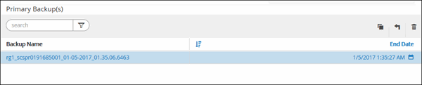

= 使用 SnapCenter 还原和恢复自动发现的数据库备份
:allow-uri-read: 
:icons: font
:imagesdir: ../media/

[role="lead"]
您可以使用 SnapCenter 从一个或多个备份还原和恢复数据。

.开始之前
* 任何应用程序都不应连接到数据库。SnapCenter 会检查连接，如果存在任何连接，则还原操作将失败。
* 您必须已备份资源或资源组。
* 您必须已取消要还原的资源或资源组当前正在进行的任何备份操作。
* 任何应用程序都不应连接到数据库。SnapCenter 会检查连接，如果存在任何连接，则使还原失败。
* 对于还原前、还原后、挂载和卸载命令、您应通过以下路径检查这些命令是否位于插件主机上的命令列表中：
+
** Windows 主机上的默认位置： `C:\Program Files\NetApp\SnapCenter\Snapcenter Plug-in Creator\etc\allowed_commands.config`
** Linux 主机上的默认位置： `/opt/NetApp/snapcenter/scc/etc/allowed_commands.config`

NOTE: 如果命令列表中不存在这些命令、则操作将失败。

.关于此任务
* 当您选择完整资源时，SnapCenter 会使用单文件 SnapRestore （SFSR） 还原数据库。它不会还原卷，并且不会为自动发现的 Db2 资源提供卷还原。该表描述了为每种存储类型还原的内容。
* 数据文件是数据库存储路径、表空间容器、本地数据库目录和数据库路径下的文件。活动日志路径、实例主目录和归档日志路径被排除在外。
* SnapCenter 在还原后不运行 Db2 `ROLLFORWARD` 命令，并且不支持自动恢复。对于具有归档日志记录的数据库，请在还原完成后手动运行 `ROLLFORWARD`。
* 当您从二级（镜像或保管库）备份进行还原时，SnapCenter 将使用相同文件（NAS）或 LUN（SAN）的 SnapMirror 还原。

下表介绍了 SnapCenter 如何根据存储类型执行自动发现资源的完整资源还原。

|===
| 存储 | 完成资源还原 

 a| 
NAS
 a| 
仅记录的 Db2 数据文件的 SFSR。未使用卷还原。Db2 在线（活动）日志和归档日志不会还原，因此备份后写入的事务仍可用于前滚。

 a| 
SAN
 a| 
整个 LUN 的 SFSR - 包含数据文件的文件系统后面的每个 LUN。这些 LUN 上的其他内容也会被还原，包括与数据共享 LUN 的日志文件。仅保存日志或归档文件的文件系统不会被还原。

|===
对于 ONTAP 9.12.1 及更早版本，在恢复过程中从 SnapLock Vault 快照创建的克隆将继承 SnapLock Vault 到期时间。在 SnapLock 到期时间过后，存储管理员必须手动清理克隆。

.步骤
. 在左侧导航窗格中，选择*Resoles*，然后从列表中选择相应的插件。
. 在资源页面中，根据资源类型从 * 视图 * 下拉列表中筛选资源。
+
此时将显示资源以及类型，主机，关联的资源组和策略以及状态。

+

NOTE: 虽然备份可能针对某个资源组，但在还原时，您必须选择要还原的各个资源。

+
如果资源未受保护，则会在“总体状态”列中显示  `Not protected`。这可能意味着资源未受保护，或者资源是由其他用户备份的。

. 选择资源，或选择一个资源组，然后选择该组中的一个资源。
+
此时将显示资源拓扑页面。

. 在管理副本视图中，从主存储系统或二级（镜像或存储）存储系统中选择 * 备份 * 。
. 在主备份表中，选择要从中还原的备份，然后单击 **
+

. 在 Restore Scope （还原范围）页面中，选择 *Complete Resource* （完整资源）以还原 Db2 数据库的记录数据文件（NAS）或 LUN（SAN）。
. 在“操作前”页面中，输入要在还原作业之前运行的预还原命令。对于自动发现的资源，不显示“卸载”命令字段。此步骤为可选步骤。
. 在“操作后”页面中，输入要在还原作业后运行的还原后命令。对于自动发现的资源，不显示挂载命令字段。此步骤为可选步骤。
. 在通知页面的 * 电子邮件首选项 * 下拉列表中，选择要发送电子邮件的场景。
+
您还必须指定发件人和收件人电子邮件地址以及电子邮件主题。此外，还必须在 * 设置 * > * 全局设置 * 页面上配置 SMTP 。

. 查看摘要，然后选择*完成*。
. 通过选择*Monitor*>*Jobs*来监视操作进度。

.完成后
* *归档日志记录* SnapCenter 将数据库初始化为 `MIRROR`，并且它保持在 `DB pending`状态。SnapCenter 在初始化后检查前滚状态。如果状态既不是 `DB pending`也不是 `not pending`，则还原作业将失败。手动运行 `ROLLFORWARD DATABASE <name> TO END OF LOGS AND STOP`或恢复到某个时间点。在 NAS 上，日志不会被覆盖，因此您可以前滚到日志末尾。
* *循环日志记录* SnapCenter 将数据库初始化为 `SNAPSHOT`，无需前滚。

