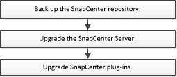

= SnapCenter 服务器升级工作流程
:allow-uri-read: 
:icons: font
:imagesdir: ../media/

[role="lead"]
每个 SnapCenter 版本都包含一个更新的 SnapCenter 服务器和插件软件包。插件软件包更新随 SnapCenter 安装程序一起分发。您可以将 SnapCenter 配置为检查可用更新。

工作流列出了升级SnapCenter服务器和插件包必须完成的任务。

[[recommended-upgrade-path]]
== 建议的升级路径

NetApp 建议升级到受支持的最新 SnapCenter 版本 6.2.3，以确保与 SnapCenter 的兼容性和最佳性能。

CAUTION: 要从早于 6.0 的版本或从 6.0 版本升级到 SnapCenter 6.2.3，请先升级到支持 .NET 8 和 Java 11 的 6.1P3，然后再升级到支持 .NET 10 和 Java 17 的 6.2.3。请勿使用 6.2.2 或任何其他中间版本作为升级路径的一部分，除非您已经在使用它。

有关升级主机的更多详细信息，请参阅 link:https://library.netapp.com/ecm/ecm_download_file/ECMLP3359467["SnapCenter 发行说明"^] 中的 *将主机升级到 SnapCenter 6.2.3*。

[[supported-upgrade-paths]]
=== 支持的升级路径

本节显示您可以从哪些SnapCenter版本升级以及支持哪些插件版本。

NOTE: 如果将SnapCenter Server 升级到 6.2，也请将插件升级到 6.2。

|===
| 如果您使用的是SnapCenter 服务器版本... | 您可以直接将SnapCenter 服务器升级到... | 支持的插件版本 

.4+| 6.0.1 | 6.1  a| 
* 6.0.1
* 6.1

| 6.2  a| 
* 6.2

| 6.2.1  a| 
* 6.2.1

| 6.2.2  a| 
* 6.2.2

.4+| 6.1  a| 
6.2
 a| 
* 6.1
* 6.2

| 6.2.1  a| 
* 6.2.1

| 6.2.2  a| 
* 6.2.2

| 6.2.3  a| 
* 6.2.2
* 6.2.3

.3+| 6.2 | 6.2.1  a| 
* 6.2

| 6.2.2  a| 
* 6.2

| 6.2.3  a| 
* 6.2.2
* 6.2.3

|===
有关将主机升级到 SnapCenter 6.2.3 的更多详细信息，请参阅 link:https://library.netapp.com/ecm/ecm_download_file/ECMLP3359467["SnapCenter 发行说明"^] 中的 *将主机升级到 SnapCenter 6.2.3*。

要了解如何升级SnapCenter Plug-in for VMware vSphere，请参阅 https://docs.netapp.com/us-en/sc-plugin-vmware-vsphere/scpivs44_upgrade.html["升级适用于 VMware vSphere 的 SnapCenter 插件"^]。
